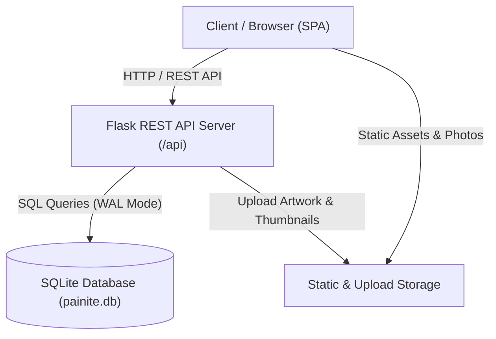

# PAINITE STUDIO — Bespoke Apparel Full-Stack Application

> *"Not just a T-shirt. A little more you."*

Painite Studio is a luxury bespoke streetwear and custom apparel platform. It pairs an interactive, real-time garment customizer with an e-commerce catalog, shopping bag drawer, patron order tracking, and an executive studio backoffice dashboard.

---

## 1. System Architecture



### Components
- **Frontend**: Single Page Application with client-side hash routing, custom interactive SVG garment canvas, real-time color switcher, custom typography renderer, artwork upload, slide-out shopping bag drawer, wishlist archive, patron order history with tracking stepper, and studio admin management.
- **Backend**: Python Flask 3 REST API with token-based HMAC-SHA256 authentication, PBKDF2 password hashing, CORS preflight handling, Pillow-based image validation, and role-based access control (`customer` vs `admin`).
- **Database**: SQLite with Write-Ahead Logging (`WAL`), foreign key enforcement, automatic migrations, and initial seed data.

---

## 2. Default Test Accounts

| Role | Email | Password | Access Level |
|---|---|---|---|
| **Admin** | `admin@painite.studio` | `PainiteAdmin!42` | Full backoffice KPI analytics, order status management, product catalog curation |
| **Customer** | `customer@painite.studio` | `PainiteUser!42` | Browse catalog, bespoke studio customizer, order checkout, order tracking |

*Quick login buttons are built directly into the sign-in modal for 1-click testing.*

---

## 3. Quickstart & Installation

### Prerequisites
- Python 3.10+ (Python 3.13 tested and verified)

### 1. Install Dependencies
```powershell
pip install -r requirements.txt
```

### 2. Configure Environment (Optional)
```powershell
cp .env.example .env
```

### 3. Launch the Application
```powershell
python run.py
```
Open **[http://127.0.0.1:5000](http://127.0.0.1:5000)** in your browser.

---

## 4. REST API Specification

### Authentication (`/api/auth`)
- `POST /api/auth/register` — Create new customer/admin account (`name`, `email`, `password`)
- `POST /api/auth/login` — Sign in and receive Bearer token (`email`, `password`)
- `GET /api/auth/me` — Retrieve authenticated user profile (Requires `Authorization: Bearer <token>`)
- `POST /api/auth/logout` — Invalidate user session

### Products (`/api/products`)
- `GET /api/products` — Catalog query with filters:
  - `search` (text search in name, description, category)
  - `category` (`All`, `Core`, `Studio`, `Edition 01`)
  - `sort` (`featured`, `price-asc`, `price-desc`, `name`)
- `GET /api/products/<id>` — Retrieve single product specifications

### Orders (`/api/orders`)
- `POST /api/orders` — Place order with items, customizer text/artwork specs, address, payment method
- `GET /api/me/orders` — Retrieve patron's order history with tracking status

### Admin Studio (`/api/admin`)
- `GET /api/admin/stats` — Executive KPIs: total revenue, order count, active products, patron count
- `GET /api/admin/orders` — Retrieve all studio orders with items & buyer information
- `PATCH /api/admin/orders/<id>` — Update order status (`Pending`, `In Production`, `Quality Check`, `Shipped`, `Delivered`, `Cancelled`)
- `POST /api/admin/products` — Add new bespoke piece to catalog
- `DELETE /api/admin/products/<id>` — Remove piece from catalog

### Upload (`/api/upload`)
- `POST /api/upload` — Upload customer artwork or product photo (sanitized and validated via Pillow)

### WhatsApp Notifications (`/api/admin/orders/.../notify`)
- `POST /api/admin/orders/<id>/notify` — Dispatch real-time WhatsApp order updates to customer
- `POST /api/admin/orders/notify-all` — Broadcast WhatsApp notifications across all active orders

---

## 5. Running the Test Suite

Run the full automated test suite covering authentication, products, order workflow, WhatsApp notifications, and separate admin panels:

```powershell
python -m unittest discover -s backend/tests -p "test_*.py" -v
```

All 32 automated tests run against live SQLite transactions and verify 100% of critical paths.

---

## 6. GitHub & Vercel Deployment

PAINITE Studio is configured for zero-config Vercel cloud deployment with serverless Python and SQLite automatic `/tmp` persistence.

### Step 1: Push to your GitHub Repository

If you haven't linked your repository yet:
```powershell
# 1. Initialize remote origin (replace YOUR_USERNAME and YOUR_REPO)
git remote add origin https://github.com/YOUR_USERNAME/YOUR_REPO.git

# 2. Stage and commit
git add .
git commit -m "Deploy PAINITE Studio to GitHub and Vercel"

# 3. Push to master branch
git push -u origin master
```

### Step 2: Deploy on Vercel

1. Log in to [Vercel](https://vercel.com) and click **"Add New..." > "Project"**.
2. Select your imported GitHub repository (`YOUR_REPO`).
3. Leave all Build & Output Settings as default (`vercel.json` and `api/index.py` handle routing automatically).
4. *(Optional)* In **Environment Variables**, add:
   - `SECRET_KEY`: A secure random string for JWT token signing.
   - `WHATSAPP_PHONE_NUMBER_ID`: (Optional) Your Meta Cloud API Phone Number ID.
   - `WHATSAPP_ACCESS_TOKEN`: (Optional) Your Meta WhatsApp Cloud permanent/system token.
   - `WHATSAPP_BUSINESS_NUMBER`: `919359615919` (Defaults to your configured business number).
5. Click **"Deploy"**. Your live storefront and admin panel will be live globally on your `*.vercel.app` domain!

